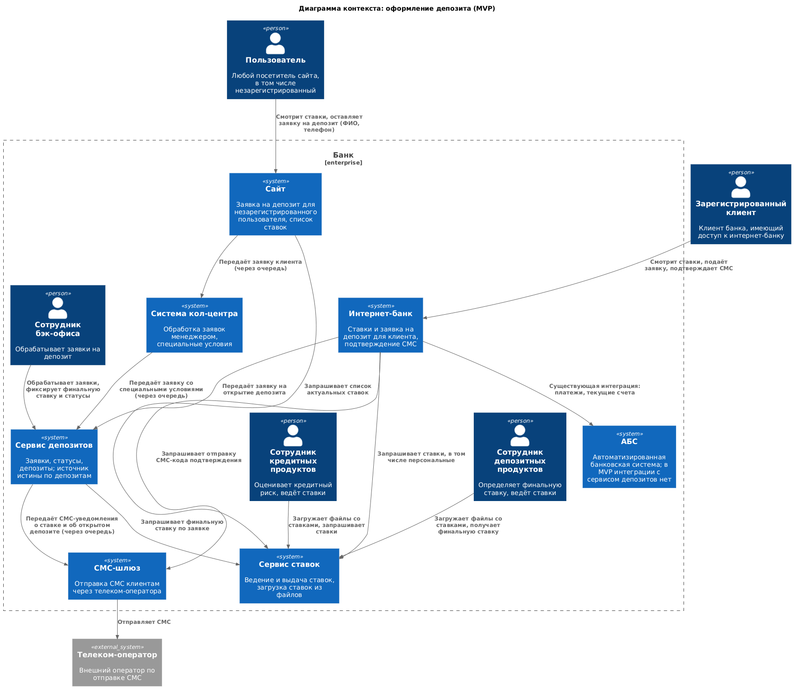
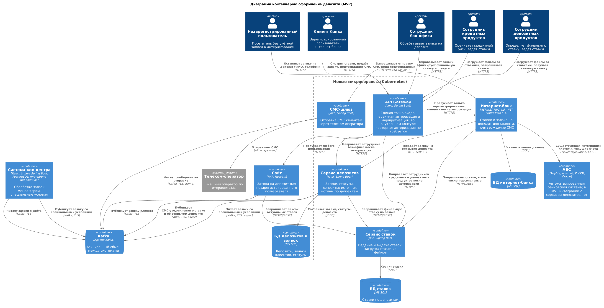

### **Название задачи:** MVP "Открытие депозита онлайн"
### **Автор:** Лукашев Михаил
### **Дата:** 29.10.2026
### **Функциональные требования**
Опишите здесь верхнеуровневые Use Cases. Их нужно оформить в виде таблицы с пошаговым описанием:

|**№**|**Действующие лица или системы**|**Use Case**|**Описание**|
| :-: | :- | :- | :- |
|1|Незарегистрированный пользователь, Сайт, Система кол-центра, Сотрудник кол-центра, Сервис депозитов, Сотрудник фронт-офиса, Сотрудник бэк-офиса|Оформление заявки на депозит с сайта для незарегистрированного пользователя|а) пользователь переходит на сайт банка, он не клиент банка, его данных нет в системе б) пользователь подает заявку на депозит, указав ФИО и телефон в) Сайт отправляет заявку в систему кол-центра, ее обрабатывает сотрудник и заносит специальные условия в сервис депозитов г) пользователь идет в отделение для идентификации д) пользователь подтверждает личность, подписывает документы и становится клиентом банка е) сотрудник фронт-офиса через сотрудника бэк-офиса открывает депозит клиенту в сервисе депозитов|
|2|Зарегистрированный пользователь, Интернет-банк, Сервис ставок, Сотрудник бэк-офиса|Оформление заявки на депозит в интернет-банке для зарегистрированного пользователя|а) зарегистрированный пользователь заходит в интернет-банк б) интернет-банк обращается в сервис ставок и предоставляет пользователю информацию с актуальными ставками и персонализированными лично для него ставками в) пользователь выбирает депозит, счет и сумму депозита; подтверждает заявку через СМС, и заявка считается оставленной г) сотрудник бэк-офиса исполняет заявку клиента и финализирует открытие депозита в сервисе депозитов|
|3|Сотрудник бэк-офиса, Сотрудник кредитных продуктов, Сотрудник депозитных продуктов, Сервис депозитов, Сервис ставок, Клиент|Обработка заявки на депозит менеджером бэк-офиса|а) Сотрудник получает заявку в сервисе депозитов, и она переходит в статус "в работе" б) Сотрудник бэк-офиса направляет запрос на получение кредитного риска клиента сотруднику кредитных продуктов в) Сотрудник кредитных продуктов запрашивает информацию у сервиса ставок и отправляет итог оценки сотруднику депозитных продуктов; заявка переходит в статус "на оценке риска" г) Сотрудник депозитных продуктов на основе данных от сотрудника кредитных продуктов получает финальную ставку от сервиса ставок д) Сотрудник бэк-офиса фиксирует ставку в сервисе депозитов; заявка переходит в статус "ставка согласована" е) Клиенту приходит уведомление о финальной ставке через СМС ж) Сотрудник бэк-офиса обновляет в сервисе депозитов статус заявки по заведению депозита на "открыт" з) Клиенту приходит СМС-уведомление об открытии депозита|
### **Нефункциональные требования**
Опишите здесь нефункциональные требования и архитектурно значимые требования.

|**№**|**Требование**|
| :-: | :- |
|R|**Надёжность (Reliability)**|
|R1|Доступность платформы 99.9%.|
|R2|Режим работы 24/7.|
|P|**Производительность (Performance)**|
|P1|Отклик по всем синхронным операциям < 300 мс.|
|P2|Должна быть предусмотрена поддержка горизонтального масштабирования всех новых компонентов системы, включая мощности ЦОД, с балансировкой трафика.|
|+R|**+ Ограничения (Restrictions)**|
|+R1|Для разработки бэкенда можно использовать Java и Spring Boot.|
|+R2|Используем микросервисы для новой функциональности с развертыванием в Kubernetes.|
|+R3|Шифрование трафика: TLS не ниже 1.2 для всех каналов.|
|+R4|Интернет-банк не должен работать напрямую с API АБС — взаимодействие через очередь или события для защиты перегруженной БД.|
|+R5|Система должна иметь отдельный от ядра интернет-банка СМС-функционал.|
|+R6|Интернет-банк. Клиент-серверная система на веб-фреймворке ASP.NET MVC 4.5 на основе .NET Framework 4.5 и СУБД MS SQL.|
|+R7|Сайт — PHP и React.js.|
|+R8|Система кол-центра должна вместо АБС начать писать заявки в Kafka (интеграция с АБС для передачи заявок заменяется отправкой в очередь).|
### **Решение**
Приведите диаграммы контекста и контейнеров в модели C4. Опишите там основные компоненты и интеграции всех элементов решения. 

Также опишите, какой логикой вы руководствовались в ходе принятия решений и выбора технологий. Не забывайте, что необходимо учесть все функциональные и нефункциональные требования.

**Примечание.** Система партнёрского кол-центра на диаграммах контекста и контейнеров пока не показана: её интеграция будет проработана отдельно в Task 4 (в рамках требования +R8 система кол-центра пишет заявки в Kafka вместо АБС).

**Логика**: 
нужно обеспечить **высокую доступность системы**, **повысить отклик**. В текущей реализации система АБС итак нагружена (БД перегружена) - добавлять новый функционал туда плохая идея.

Также это PL SQL система с вертикальным способом масштабирования, что дорого и не подходит под критерии обеспечения доступности. В нашем случае доступность - выпал один под, работает другой (репликация).

Таким образом, с целью разгрузки БД мы выносим логику работы с депозитами в отдельный сервис с отдельной БД, пока с ним работает сотрудник бэк офиса. А логику работы со ставками мы 
добавляем в новый сервис, чтобы не добавлять это в АБС. Также, что можно (смс, создание заявок) мы обрабатываем через async для повышения производительности.

Так мы сможем обеспечить доступность сервиса 99.9%, его горизонтальную масштабируемость и с минимальными правками начнем распил монолитной legacy процедурной АБС.

### **Альтернативы**
**Альтернативы**:  
1) Реализовать новый функционал в АБС - быстро в плане доработок, но скорее всего даже в рамках MVP провалиться: требуемый уровень отклика получить будет сложно даже с async запросами к АБС. Горизонтальное масштабирование также реализовать не получиться из-за легаси системы, при условии, что БД уже перегружена.  
2) Реализовать только сервис ставок отдельно - быстрее, более оптимально, чем п1, но все равно не лучший вариант. Сервис депозитов более устойчив к сбоям из-за микросервисной архитектуры, чем процедуры в АБС; также у него будет быстрее отклик. Но что не менее важно: получится начать распил монолитной АБС в рамках MVP, получить очень полезный опыт, что поможет в будущих этапах цифровой трансформации банка.

**Недостатки, ограничения, риски**
- Создание новых сервисов 
- Разворачивание кафка кластера
- Если в текущей архитектуре не было async - более долгая разработка и обработка асинхронного взаимодействия
- Более долгие этапы тестирования и ввода в эксплуатацию 
