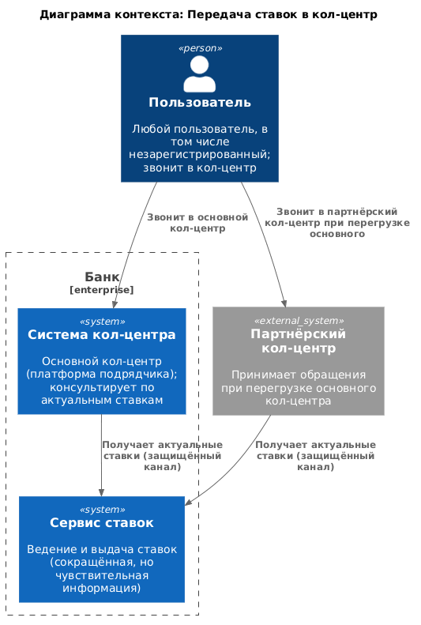
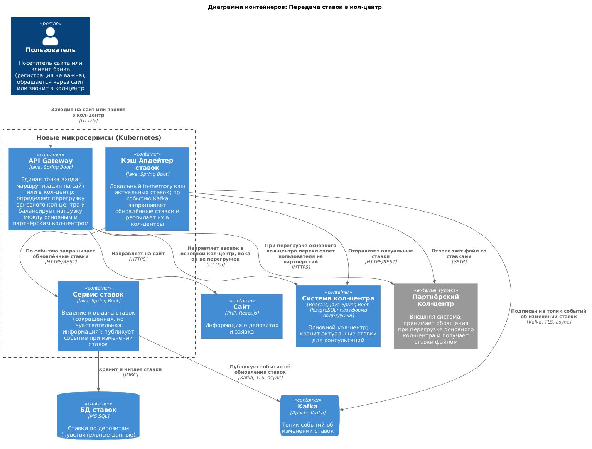

### **Название задачи:** Получение ставок депозитов через колл-центр
### **Автор:** Лукашев Михаил
### **Дата:** 29.10.2026
### **Функциональные требования**
Опишите здесь верхнеуровневые Use Cases. Их нужно оформить в виде таблицы с пошаговым описанием:

|**№**|**Действующие лица или системы**|**Use Case**|**Описание**|
| :-: | :- | :- | :- |
|1|Пользователь, Gateway, Сотрудник партнёрского колл-центра, Система партнёрского колл-центра|Получение информации о ставке депозита через партнёрский колл-центр, когда основной колл-центр загружен|а) пользователь звонит в банк б) банк понимает, что основной колл-центр загружен в) звонок перенаправляется в партнёрский колл-центр г) пользователь просит у сотрудника информацию о ставке депозита д) сотрудник колл-центра в UI системы партнёрского колл-центра запрашивает информацию о ставке е) в течение нескольких секунд актуальные ставки на момент обращения показываются в UI системы партнёрского колл-центра ж) сотрудник партнёрского колл-центра сообщает информацию о ставке клиенту|
|2|Пользователь, Gateway, Сотрудник колл-центра, Система колл-центра банка|Получение информации о ставке депозита через основной колл-центр, когда он не загружен|а) пользователь звонит в банк б) банк понимает, что основной колл-центр не загружен в) звонок остаётся в основном колл-центре банка г) пользователь просит у сотрудника информацию о ставке депозита д) сотрудник основного колл-центра в UI системы колл-центра банка запрашивает информацию о ставке е) в течение нескольких секунд актуальные ставки на момент обращения показываются в UI системы колл-центра банка ж) сотрудник основного колл-центра сообщает информацию о ставке клиенту|
### **Нефункциональные требования**
Опишите здесь нефункциональные требования и архитектурно значимые требования.

|**№**|**Требование**|
| :-: | :- |
|R|**Надёжность (Reliability)**|
|R1|Режим работы 24/7.|
|R2|Доступность ставки 99%.|
|P|**Производительность (Performance)**|
|P1|Получение файла со ставками не дольше секунды в пиковых нагрузках.|
|P2|Поддержка горизонтального масштабирования.|
|+R|**+ Ограничения (Restrictions)**|
|+R1|Партнёрский колл-центр не может предоставить API — используем протокол SFTP.|
|+R2|Для разработки бэкенда можно использовать Java и Spring Boot.|
|+R3|Разработанный микросервис нужно развернуть в Kubernetes.|
|+R4|Уже есть gateway, его логику нужно доработать для определения загруженности колл-центра.|
### **Решение**
Приведите диаграммы контекста и контейнеров в модели C4. Опишите там основные компоненты и интеграции всех элементов решения. 

Также опишите, какой логикой вы руководствовались в ходе принятия решений и выбора технологий. Не забывайте, что необходимо учесть все функциональные и нефункциональные требования.

### **Альтернативы**
Опишите здесь наиболее важные альтернативные решения.
1) Использовать кэш Redis. Минусы - дополнительная инфра; также через SFTP напрямую не отправить из Редиса файл, все равно нужен адаптер. Кафка уже есть в инфре, логично ее переиспользовать.
2) Передавать в топике Kafka файл. Файл со ставками неописанного размера (может быть > 1mib). Через кафку лучше не передавать файлы большого размера.
3) Не использовать кафку. Блокирующие вызовы - блокировка адаптера; ниже пропускная способность.
4) Не использовать локальный кэш. Тогда придется каждый раз ходить в БД - дорого. Ставка не обновляется каждую секунду, нет смысла в лишних запросах.

**Недостатки, ограничения, риски**

Подробно опишите здесь недостатки, ограничения и риски выбранного решения.
1) Локальный кеш придется прогревать после рестарта. Кэш не планируется большой - прогрев не должен занять много времени.
